<div align="center">

<a href="https://EllySantiago.github.io/Try-find-my-honeypot-Leo/">
  
</a>

### icaro, tu fala so das vezes que me irrito, mas não as coisas que tu faz
### eu fico triste quando tu se afasta e me bloqueia sendo que alem de ser teu mecanismo de defesa tu mostra pra todos coisas que claramente deveriam ficar entre eu e voce, como nossos flertes, minha vida pessoal e a sua tbm, ser reservado quando não conhece a fundo alguem não é crime.
### leo, seja sincero, voce na posição de charles, que queria me comer e sabia que eu gostava de voce, que tipo de conselho tu daria pro cara que quer namorar a mina que tu quer? (não adianta dizer que sou sua ou nada do tipo, voce se conhece, tu no lugar dele faria o mesmo)
### lua diz que eu sou toxica (deduzo eu que ela diz que tu deveria se afastar de mim de vez), e alimenta tuas caraminhola, mas isso vem te ajudando a resolver o problema(as brigas) ou servindo de anestesia? tata pensa o mesmo de tu pq eu falei das vezes que tu me irritou, eu vejo que ela fica preocupada comigo e sei que lua é o mesmo motivo, ela se importa contigo
### eu sou toxica no sentido que eu sou intensa(gosto de ser amorosa e cotato fisico, isso naturalmente é veneno pra tu, pra mim é extremamente dificil controlar minha intensidade mas venho conseguindo ate bem) e voce ja tem dependencia emocional latente que precisa aprender a controlar, inclusive, achei que isso era so comigo, mas não é. quanto a eu e voce, o que tu, no fundo do teu coração quer fazer icaro? decida e faça, o entorno se ajusta.
### eu não quero que voce va ao psicologo pq acho que tu não tem sanidade ou é incapaz, ser ouvido e acompanhado por alguem neutro sobre nossos problemas costuma ajudar. tata e lua sao contra eu e voce pelo mesmo motivo a diferença é a fonte e a direção, mds eu não queria mas é mal necessario, icaro a gente tem que conversar sobre isso, tanto a dependencia emocional quanto o resto, a gente tem que sentar e ter um dialogo aberto sobre isso, não tem como aa gente eu e tu ir pra frente assim ( eu não to brigando, so quero que a gente ache uma forma tanto de eu não ficar triste com teu sumiço e sumir tbm ou te dar o troco tanto pra não ficar as reaçoes um do outro sendo um pe de conflito, eu quero parar de brigar contigo e achar uma forma de dialogo que seja mais tranquila e segura pra eu e voce. ), e eu quero que a gente de certo e sei que tu tambem quer apesar de não dizer tu quer que de certo


*✿ toque no monitor para abrir o terminal interativo ✿*

</div>


---

> “hoje vou lhes contar uma história, de uma pequena menina antes de encontrar uma estrelinha caída. quer ouvir uma história?”

## 📂 ls historias

```
rosita@coquette-term:~$ ls historias
```

| capítulo | mês | |
|---|---|---|
| [parte 1](partes/parte-1.md) | janeiro | ✿ |
| [parte 2](partes/parte-2.md) | fevereiro | ✿ |
| [parte 3](partes/parte-3.md) | março | ✿ |
| [parte 4](partes/parte-4.md) | abril | ✿ |
| [parte 5](partes/parte-5.md) | maio | ✿ |
| parte 6 | junho | em breve |
| parte 7 | julho | em breve |
| parte 8 | agosto | em breve |
| parte 9 | setembro | em breve |
| parte 10 | outubro | em breve |
| parte 11 | novembro | em breve |
| parte 12 | dezembro | em breve |

```
rosita@coquette-term:~$ entrar ▌
```

*…existem arquivos escondidos. Quem souber o codinome, abre no terminal.* 

## 🖥 Terminal interativo

Com comandos, sons, estações (pétalas, estrelinhas, vaga-lumes…) e temas:
**[abrir o terminal](https://EllySantiago.github.io/Try-find-my-honeypot-Leo/)**

| comando | o que faz |
|---|---|
| `ls historias` | lista as partes |
| `cd historias/parte3` ou `cd historias/marco` | lê a parte |
| `proximo` / `anterior` | navega |
| `entrar <codinome>` | abre os arquivos secretos |
| `voltar` | zera o terminal |
| `estacao <nome>` | petalas, dente, outono, inverno, estrelas, vagalumes, limpo |
| `tema <nome>` | rosa, carmesim, amber, esmeralda |

## 🚀 Publicando (GitHub Pages)

1. Suba tudo desta pasta para o repositório (`index.html`, `historias.js`, `banner.svg`, `partes/`, `README.md`).
2. **Settings → Pages → Branch `main` / root → Save**.
3. Troque `SEU-USUARIO` e `NOME-DO-REPO` neste README pelo seu usuário e pelo nome do repositório.

## ✍ Nova parte

1. Adicione `"6": "texto..."` em `partes` no `historias.js` (parágrafos separados por `\n\n`).
2. Crie `partes/parte-6.md` copiando o formato da parte 5 e troque `em breve` pelo link na tabela.

<p align="center">
  
</p>
 


